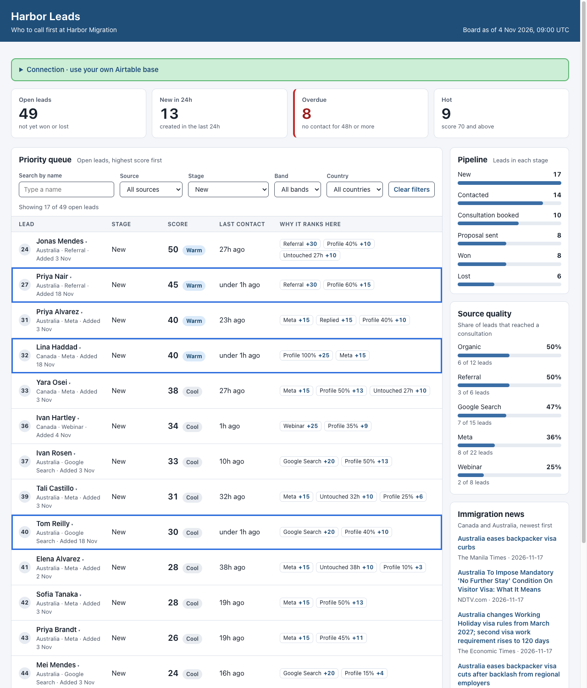

# Harbor Migration · AI lead intake (Make)

A Make scenario that takes a new lead from a website form, lets AI decide whether it is a real lead, and writes it to Airtable. Accepted leads appear on the live sales dashboard: <https://sianitomer-web.github.io/aido-leads-dashboard/>. Rejected leads are kept with the AI's reason, so a person can review every decision.

Harbor Migration is a fictional immigration consultancy (Canada and Australia). Every lead in this repo is fictional.

## How it works

```
Webhook ─► Make AI (Extract) ─► Router ─┬─ Accepted ─► Airtable: Leads    ─► Reply {"status":"accepted", …}
                                        └─ Rejected ─► Airtable: Rejected ─► Reply {"status":"rejected","reason":…}
```

| # | Module | What it does |
|---|--------|--------------|
| 1 | Custom webhook | Receives the lead: `name`, `source`, `message` (free text) |
| 2 | Make AI Toolkit · Extract information | Answers four closed questions about the message: `is_real_lead` (yes/no), `country` (Canada / Australia / Other), `completeness` (0–100, how many of five profile items the lead gave: age, occupation, English level, education, family status), `reason` (one sentence) |
| 3 | Router | Splits the flow on the AI's answers |
| 4 | Airtable · Create a record (`Leads`) | A real lead for Canada or Australia becomes a new lead in stage `New`, with `created_at` = now. The dashboard scores it and shows it in the queue |
| 5 | Webhook response | Tells the sender `accepted`, with the country and completeness |
| 6 | Airtable · Create a record (`Rejected`) | Spam, or a destination we do not serve, goes to a review table with the AI's reason and a `reviewed` checkbox |
| 7 | Webhook response | Tells the sender `rejected`, with the reason |

**Why a webhook and not a schedule:** the scenario runs only when a lead arrives, so empty checks cost no credits.
**Why closed questions for the AI:** a yes/no, a value from a fixed list and a number fit straight into Airtable fields. Free text would break the select fields.
**Why a Rejected table:** the AI decides, but nothing it drops is lost. A person can see every rejection and why.

## Files

| File | What it is |
|------|------------|
| `blueprints/harbor-lead-intake.blueprint.json` | The scenario, exported from Make (Blueprint) |
| `test-leads.json` | Five test leads, what each should do, and the reply each got |

## Test run (18 Nov 2026)

| Lead | Expected | Result |
|------|----------|--------|
| Lina Haddad · Canada · full profile | accepted, 100 | accepted, 100 |
| Tom Reilly · Australia · age + job | accepted, 40 | accepted, 40 |
| Best SEO Agency · spam | rejected | rejected · "Spam ad; not about immigrating or studying." |
| Jonas Weber · Germany | rejected | rejected · "Not a lead for Canada or Australia." |
| Priya Nair · Australia · 3 items | accepted, 60 | accepted, 60 |

The three accepted leads on the live dashboard (Stage filter: New; the new leads are outlined):



The first run used the AI's *Small* model, which scored Lina 60 instead of 100. Switching to *Medium* fixed it. Cost: about 3 credits per lead.

## Import it into your own Make account

1. In Make: **Scenarios › Create a new scenario › ⋯ › Import Blueprint**, and choose `blueprints/harbor-lead-intake.blueprint.json`.
2. Open the webhook module and create a new webhook. Copy its URL.
3. Open the Make AI module and choose a connection (*Make's AI Provider* needs no API key).
4. Open both Airtable modules, connect your Airtable account, and pick your base and tables. The `Leads` table needs the columns listed in the dashboard's README; the `Rejected` table needs `name`, `received_at`, `source`, `message`, `ai_is_real_lead`, `ai_country`, `ai_reason`, `reviewed`.
5. Turn the scenario on and send a test lead:

```bash
curl -X POST "<your webhook URL>" \
  -H "Content-Type: application/json" \
  -d '{"name":"Test Lead","source":"Meta","message":"Nurse, 32, IELTS 7.5, wants to move to Canada"}'
```

The blueprint holds no data, passwords or tokens. The connection, webhook, base and table IDs in it point to the author's account and do nothing elsewhere; steps 2–4 replace them. The live webhook URL is not published.
